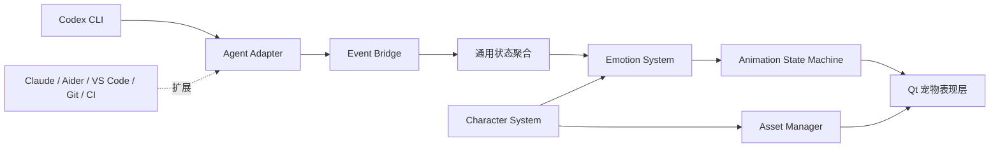

# Mori Companion（茉伴）

个人 AI Desktop Companion 基础架构，基于 [kmjs1915/CeTaPet-AI-DeskTopPet-DeepSeek](https://github.com/kmjs1915/CeTaPet-AI-DeskTopPet-DeepSeek) 重构。默认沿用鲸鱼娘角色设定和原桌宠交互，角色动作已按新版互动原画统一重绘，项目与核心事件不绑定任何 AI 厂商。

当前版本 0.4.0：Codex **CLI** 是第一个 Agent Adapter；Claude Code、Aider、VS Code、Git、CI 可以通过相同事件协议扩展。九种默认动作均使用四张独立关键姿势，工作状态自动驱动情绪与动作。娱乐／专注模式支持四向步态、触摸拖拽、鼠标互动和窗口小剧情，动画之间采用短暂平滑过渡。运行时不连接生图服务；Live2D、Spine、Rive 预留渲染后端接口。

## 运行

Python 3.11+，唯一运行依赖是 PySide6。Linux 桌面与 Windows 可使用源码入口；测试环境为 Linux / Python 3.14 / PySide6 6.11.2。

```bash
python -m pip install -e .
mori-companion
```

Linux 应用菜单入口可通过 `.venv/bin/python scripts/install_desktop.py` 注册；脚本同时安装 `~/.local/bin` 启动入口。当前本机项目位于 `/home/henry/Software/MoriCompanion`。迁移项目后重新安装 editable 包并运行该脚本，即可更新菜单路径。

也可以从源码启动：

```bash
python -m pip install -r requirements.txt
python src/main.py
```

左键互动，按住拖动移动角色，右键打开聊天、工具状态、资料、重置位置、隐藏和退出菜单。登场后继续原有 nothing / eat / think 待机轮转。隐藏时事件桥仍运行，停止待机计时和气泡；有托盘时关闭窗口会隐藏到托盘，双击托盘恢复。没有托盘的桌面环境中关闭窗口会退出。

Linux Wayland 桌面上，如果提供 XWayland 显示和 Qt xcb 插件，启动器会自动使用 xcb 兼容后端，让绝对坐标拖拽和窗口置顶正常工作。显式设置的 `QT_QPA_PLATFORM` 会保留；强制使用原生 Wayland 时，窗口移动与置顶仍受合成器限制。KDE Wayland 上已确认拖拽和置顶恢复。右键现在直接打开可复用菜单，避免依赖后端是否额外派发 contextMenuEvent。

消息使用头顶的圆形思考气泡，以两个小圆点连接角色。位置按实际可见头部对齐，探头和坐窗沿时计入姿势偏移；同一姿势播放期间保持稳定，随角色位移而移动。空间足够时避开正在互动的软件窗口，头顶靠近屏幕边缘时改放侧面。气泡属于桌宠的 `ToolTip`，不接收焦点和鼠标输入；连续消息复用一个窗口，文字变化时合并尺寸与位置更新。气泡仍显示约 3 秒，隐藏桌宠时同步隐藏。布局示意见 [头顶气泡预览](output/bubble-study/preview.png)。

日常气泡与动画独立调度：开启当前模式的“主动表达”及台词后，每 45 秒尝试一句碎碎念，工作时也可能突然发呆想吃饭，当前工作动画照常播放。进食入场、触摸、抓起、收纳和剧情步骤等专属台词仍随动作触发；日常台词避让动作反馈与任务提醒。具体规则见 [气泡与动画独立调度](docs/animation-modules.md#气泡与动画独立调度)。

本地台词已按 Mori 人设重写，可运行 `python scripts/export_dialogue.py` 导出带稳定编号、语气指导和建议音频路径的全量 TTS 清单。详见 [台词本与本地 TTS](docs/dialogue-scriptbook.md)。

生活内容现有 **636 条手写语料、36 张新姿势与 36 段新动画**。吃饭、发呆、困倦为主线，好奇、朋友互动和鲸鱼娘的小世界各有同等数量的内容。工作时约每 1–3 分钟插入几秒小动作，空闲时约每 30–90 秒展开小剧情，并记得近期吃过、歇过和与你互动的小事；重要提醒、点击和拖拽优先。新节奏可在互动设置调整，原有自定义频率保留。规则和预览见 [生活语料与动画](docs/living-companion.md)。

`txt` / `docx` 拖入仍触发原收纳反馈；现在复制到个人资料目录并保留原文件。聊天窗口为本地陪伴、状态查询与“搜索 关键词”，不包含远程模型对话。DeepSeek / DSh 的专用请求、余额、密钥设置及强制首次配置已经移除。

Mori 的 LLM 人设提示词位于 `src/character/prompts/mori.md`，由 qq-bridge 的小鲸鱼角色卡适配，保留上游原文和 MIT 许可。后续模型接入可通过 `from character import load_system_prompt` 加载为系统提示词；来源、适配说明和调用示例见 [Mori 人设](docs/persona.md)。

## GIF 动作与角色资源

第一批四向关键姿势动画已接入：左、右、后侧视角的伪上和正面视角的伪下，各有 4 张透明姿势，走路帧随移动距离推进。头部上方与尾巴点击分别触发摸头、怕痒护尾反应，每类有轻度／亲近／害羞 3 个层级、每层 2 种变化；连续互动递进，安静 12 秒后恢复。专注模式也保留这些主动触摸反应，结束后恢复最新工作状态；隐藏时暂停，抓起时打断。

打开 [四向步态与触摸预览](docs/motion-preview.html)，可暂停、慢放、逐帧查看及连续触摸。运行素材为 `src/asset_library/motion/` 下的 280×230 透明 PNG 与 `clips.json`，原画、提示词和分享用 GIF 位于 `output/motion-study-v1/`。运行时每个播放器只缓存当前动作的至多 4 张 PNG，不添加依赖或连接生图服务。

第二批新增左右戳脸、抓起拖动与落地收尾，共 16 张关键姿势。左右脸各有 3 层亲近程度、每层 2 种变化，分别眨眼、轻捂对应脸颊、害羞回应。拖动速度决定悬空姿势，身体轻摆与拉伸通过阻尼逐渐跟上，停下后回正并停止高频计时；抓住脚或尾巴也会限制摆幅以保留完整轮廓。松手保持当前位置，依次屈膝缓冲、站稳、整理裙摆，再恢复最新工作表情。这些主动互动在专注模式保留，沿用已有频率设置。

打开 [戳脸与拖拽落地预览](docs/gesture-preview.html)，可拖动试验台角色，也可用方向按钮、暂停与逐帧查看。原画、提示词及 14 个演示 GIF 位于 `output/gesture-study-v2/`。第一批 24 张姿势保持原样；鼠标主动反应、窗口衔接、日常与工作新动作继续按批次扩展。

第三批新增鼠标互动，共 20 张关键姿势：四个方向的眼神，以及左右分别绘制的好奇试探、害羞回望。娱乐模式下，附近鼠标只触发短暂注视，随后留出呼吸眨眼的安静间隔；完整“看一眼 → 试探 → 追几步／退一步 → 回到待机”剧情仍沿用已有频率设置。追逐实时跟随鼠标，速度上限约 100px/s，保持约 110px 的距离，最多追约 4 秒、行程约 260px；过近或快速靠近时退约 54px，再亲近地回望。当前工作状态优先，工作事件会在当前位置结束鼠标剧情。

打开 [鼠标互动预览](docs/mouse-preview.html)，可移动鼠标、切换左右试探、体验追逐与害羞分支，以及切换专注模式或关闭主动走动。专注、隐藏、明确的点击／拖拽和工作表情会让鼠标注视暂停；关闭主动走动后仍可保留原地注视。原画、提示词和 7 个演示 GIF 位于 `output/mouse-study-v3/`，前两批 40 张姿势保持原样。鼠标观察只在可互动的娱乐待机中使用 240ms 计时，不开启全局鼠标 Hook；完整剧情才使用既有 40ms 动作计时。

第四批新增窗口互动，共 20 张关键姿势、8 段动作：左右分别绘制的探头与收回、屈膝撑住窗沿坐下、双脚交替轻摆、收腿撑起身，以及思考、伸手碰按钮和收手。坐下与起身按姿势将脚底或手掌／臀部对齐同一个窗沿位置，完整身体始终保留在原有 280×230 画布内。探头仅裁剪绘制，不设置原生窗口遮罩；窗口移动时保留动作进度，离开时按当前位置重新计算步行速度。窗口贴近屏幕边缘而没有探头空间时会跳过或结束该剧情。

打开 [第四批窗沿互动预览](docs/window-preview.html)，可慢放、逐帧、选择左右探头，拖动或缩放示意窗口，以及查看专注模式中断。桌宠的 **互动设置 → 立即体验** 新增“伸手试试按钮”，只播放触碰动作；真正的最小化仍使用独立开关、原有间隔和执行前身份检查。娱乐模式沿用已有剧情频率，专注模式暂停窗口剧情并保留主动点击、拖拽和工作表情。原画、内置生图提示词及 8 个演示 GIF 位于 `output/window-study-v4/`；前三批 60 张 PNG 和 37 段动作保持原样。

第五批新增上沿趴着偷看、呼吸眨眼、思考、进食工作、等待招手、成功庆祝、失败安慰、收纳资料、伸懒腰和打盹，共 40 张独立姿势；运行清单累计 120 张 PNG、57 段动作。九种默认 GIF 已重建为四张真实姿势，触摸与悬空动作复用前面确认的姿势。前四批 80 张 PNG 保持原样。伸懒腰与打盹默认用于娱乐待机，也可在模块设置中为专注开启；工作到来时在当前位置结束休息，恢复最新工作表情。

打开 [偷看、日常与工作预览](docs/life-preview.html)，可以选择左右／上沿探头，移动或缩小示意窗口，试验贴右边、顶部缺空间，以及工作状态切换。窗口动作启动前检查整段关键姿势和走近时的步态能否完整放入可用屏幕；坐下、上沿偷看和伸手还检查窗口宽度。没有足够位置就跳过，正在播放时空间变小也会结束，指定右探头不会改成其他方向。自动探头可以选择仍有空间的一侧或上沿。

动作及关键姿势之间使用约 120ms 的可打断过渡，步态与拖拽使用更短过渡，待机眨眼约 45ms。切换过程中不降低重叠区域的不透明度，坐下／起身的大幅支撑点变化也会短暂插值；隐藏时暂停，过渡完成后停止额外计时。原画、提示词、12 个演示 GIF 和旧 GIF 存档位于 `output/life-study-v5/`。

重建第一批素材（构建时需要 Pillow）：

```bash
python scripts/build_motion_assets.py
```

重建第二批素材（同样需要 Pillow，保留第一批资源）：

```bash
python scripts/build_gesture_assets.py
```

重建第三批素材（需要 Pillow，保留前两批资源）：

```bash
python scripts/build_mouse_assets.py
```

重建第四批素材（需要 Pillow，保留前三批资源）：

```bash
python scripts/build_window_assets.py
```

重建第五批素材及九种默认 GIF（需要 Pillow；按批次顺序运行构建脚本）：

```bash
python scripts/build_life_assets.py
```

第六批新增拿笔、书写、收笔、抓握与推拉共 12 张姿势，清单累计 132 张 PNG、60 段动作。**互动设置 → 系统互动**统一开启真实窗口拖动／缩放／贴边、最小化／最大化、页面滚动、临时涂鸦和窗口标记，没有各功能的独立开关。选择操作并点击“让 Mori 操作”；娱乐模式也可自主轻拉当前窗口或最小化。滚动和涂鸦由你发起，涂鸦支持图案和至多 32 字短句，完成后停留 6 秒再淡出。屏幕涂鸦固定在屏幕，窗口标记随窗口移动、缩放；笔迹允许鼠标穿透，不写入应用。新原画与构建说明见 [system-study-v6](output/system-study-v6/README.md)。

右键或托盘 → **陪伴模式**可手动切换娱乐／专注；**互动设置**按基本、移动、鼠标互动、窗口互动、休息、主动表达、系统互动七个模块组织。基本动画固定开启，其余模块在娱乐／专注两列分别勾选；切换模式自动应用该模式保存的选择。首次默认专注只开启基本动画；娱乐默认开启其他陪伴模块，系统互动默认关闭。修改即时生效并保存到个人目录 `settings.json`，已有适配器设置保留。旧的最小化许可迁移到系统互动模块，不再保留第二个执行开关。详细分组和效果见 [模块与动画节奏](docs/animation-modules.md)。

- **专注模式**默认保留工作状态 GIF 和用户主动点击／拖拽的反馈；可以自行开启鼠标注视等模块，保存后再次切回专注仍使用这些选择。
- **娱乐模式**包含桌面散步、靠近鼠标、左右及上沿探头、坐标题栏、开心庆祝、伸懒腰、打盹，以及“走近 → 说话 → 伸手 → 最小化 → 得意离开”的剧情。主动剧情基础间隔默认 45 秒，可调为 5–300 秒，实际增加 15–35% 安静时间；已有自定义数值保留。日常台词间隔 45 秒，鼠标持续靠近时每约 6.4 秒短暂注视一次，其余时间呼吸眨眼。真实最小化默认至少间隔 180 秒，可调为 60–3600 秒。
- 移动分为散步、小跑和快跑，可按距离自动选择，也可固定步速。位移速度与步频一起变化，到达目标后立即收步，停留时使用站定动作。打盹有入睡、停留、醒来三个阶段，默认停留 40 秒，可调为 10–300 秒；工作事件会在当前位置打断主动剧情并恢复工作表情。鼠标互动结束留在鼠标附近，窗口互动结束走向随机落点。窗口靠近屏幕顶部而容不下完整姿势时会跳过动作。
- 停下时朝屏幕内侧，工作表情、主动触摸、日常动作同步转向；移动时身体使用实际位移方向的四向姿势。窗口中途移动会从当前位置重新规划走近路线，保留步态相位；坐下、起身及上沿偷看转向时，支撑点和空间检查一起更新。左右窗口探头保持各自原画朝向，伸手仍对准按钮。
- 窗口互动与真实窗口操作通过 **KDE Plasma 6 / KWin** 提供，支持本机 Wayland 普通应用窗口；其他桌面仍可体验散步、鼠标、庆祝、休息与屏幕涂鸦。排除名单按应用标识的关键词匹配，不读取窗口内容。最小化执行前再次检查活动窗口、模式和模块；目标被切走、移动、关闭或变为全屏会取消。按钮按 KWin 配置的左右位置和顺序定位并同步转身；自绘标题栏中心仍为估算，实际操作由窗口管理器执行。真实拖动按已确认的窗口位置保持手掌接触，用户接手移动或缩放时结束动作。
- 窗口目标分为置顶前台（最上层普通窗口，优先显式置顶）、前台（其他未最小化窗口，含被覆盖的窗口）和后台（最小化程序），默认权重 **8:3:1**，设置可调为 0–100；0 表示不自动选择该层。先按层选择，再在层内选择窗口，窗口数量不会改变层权重。每段剧情锁定目标，其他窗口切换不会重新选目标；目标位置更新合并为至多每 80ms 一次，保留当前动作和台词计时。后台仅在 Mori 身边问候，不恢复程序。非当前虚拟桌面／活动的窗口不参与。
- 抓住 Mori、右键、隐藏、换角色、切换模式或关闭所属模块会打断剧情。系统互动统一由当前模式的总开关控制，关闭会撤销待执行操作、结束滚动会话并清除临时笔迹。旧“节奏与系统操作”改为“节奏设置”，删除真实最小化恶作剧勾选项，最小化间隔移到系统互动。右键／托盘及设置中可**恢复上次被 Mori 最小化的窗口**，即使当前模块关闭也保留恢复入口，按原窗口标识执行。窗口已关闭时不会操作其他窗口。弹窗、对话框、桌面、面板、全屏及 Mori 自身不参与真实最小化。

Wayland 页面滚动需要系统 PyGObject/GIO（或可选依赖 `python -m pip install -e '.[desktop-input]'`），首次手动滚动会由桌面请求指针输入授权。只发送滚动，不申请键盘、截图或剪贴板。点击选择当前窗口的内容区域后保持鼠标位置，移动鼠标或切换窗口就会结束。涂鸦无需输入授权，也不需要 PyGObject。

早期静态互动原画位于 `src/asset_library/interaction/`，作为缺失素材时的兼容回退。默认 Mori 的互动已使用 `motion/` 中的独立关键姿势，Qt 负责少量重心摆动、位置插值和窗口遮挡。原画均在开发阶段用内置生图制作，运行时不生成图片，也不依赖图像生成 API 密钥。

打开 [九种 GIF 动作预览](docs/gif-preview.html) 可同时查看所有默认动作，逐帧和过渡查看请使用第五批预览。角色沿用已确认的圆蓝眼、腮红、深蓝渐变长发、女仆装与超大鲸鱼尾巴；等待轻轻招手，失败亲近地安慰，拖拽保持悬空。

每个动作的 PNG 回退和 GIF 均为 **280×230** 透明画布，与互动剧情窗口一致。九个默认 GIF 各有 **4 张独立绘制的姿势**，帧时长按动作节奏设置，待机保留较长安静停留。桌宠绘制时补充短暂姿势过渡，单次动作播放完停留在恢复姿态；普通 GIF 查看器展示原始关键姿势。

第五批高分辨率原画和提示词保存在 [life-study-v5](output/life-study-v5/README.md)，本批替换前的 GIF 保存在 `original-gifs/`。更早的单张原画和上游原始资源仍保留在 `output/character-refresh/`，默认 PNG 回退保留兼容，原有动作路径不变，自定义皮肤继续使用各自素材。

| 通用事件 / 互动 | 情绪 | GIF 动作 |
| --- | --- | --- |
| task_started / thinking | focused / curious | 托腮思考 |
| generating | focused | 进食点头 |
| waiting_input | expectant | 晃动提醒 |
| task_completed | happy | 成功庆祝 |
| task_failed | concerned | 失败安慰 |
| idle | 逐渐恢复 neutral | 呼吸与原待机轮转 |
| 点击 / 拖拽 / 收纳成功 | 保留当前工作情绪 | 触摸回应 / 悬空摆动 / 收纳资料 |

点击、拖拽等互动保持优先级，结束后恢复最新工作动作。庆祝与安慰播放至最后恢复姿态后停留，完成／失败状态约 8 秒后回到待机；思考、生成和等待随工作状态保持。重复状态更新不会从头重播 GIF；情绪强度调整工作 GIF 播放速度至原速度的 80%–100%，平静时动作更慢。隐藏时暂停解码与动作倒计时，重新显示后恢复。

右键或托盘的“角色与动作”面板支持导入皮肤 `character.json`、替换所选动作的 PNG/GIF、切换角色和移除不用的自定义皮肤。替换动作会复制当前皮肤，保留原素材；选择“鲸鱼娘”可恢复默认角色，选择会持久化。每个素材最多 2 MiB、512×512、GIF 最多 120 帧且帧间隔至少 80ms，最多保存 32 个自定义皮肤。

素材构建仅需要 Pillow（`python -m pip install -e '.[assets]'`），桌宠运行无需 Pillow，也不会连接任何生图服务。只根据当前四帧清单重新导出九种默认 GIF，可运行：

```bash
python scripts/build_gifs.py
```

## 监听 Codex CLI

先运行 Mori Companion。希望继续直接输入普通 `codex` 时，执行一次终端集成配置：

```bash
companionctl enable-codex
# 或按当前环境指定终端：
/home/henry/Software/MoriCompanion/.venv/bin/companionctl enable-codex --shell fish
```

新开终端后，在开发项目目录输入 `codex` 即可；Fish 当前终端也可执行 `source ~/.config/fish/conf.d/mori-companion.fish` 加载。已有 Codex 会话需退出并重新启动监控入口，也可用 `codex resume` 选择原会话。配置只给交互终端添加同名函数，不替换 Codex 可执行文件或改写全局配置；GUI / 非交互启动方式保持原入口。

显式入口同样在开发项目目录运行：

```bash
mori-codex
mori-codex resume --last
# 未安装包时：
python /home/henry/Software/MoriCompanion/src/mori_codex.py
```

本机验证版本是 **codex-cli 0.160.0**。交互启动使用一个私有本地 app-server，原生终端 CLI 通过 Unix WebSocket 连接；Mori 旁路读取消息，原样转发协议，不回答、不审批或改写请求。终端退出后回收该后端与临时套接字，不接入 GUI 的共享 daemon。接口依据 [官方 app-server 文档](https://learn.chatgpt.com/docs/app-server) 和本机导出的 schema；实验接口变化可能影响后续版本。

气泡显示 **原生任务名＋Codex 原文开头**；原生自动取名完成后同步更新，暂时没有名字时使用第一条任务描述的短名。捕获的是 assistant 的文字描述、最终回答及异步文字，排除推理、工具输出、历史记录预读、子代理普通文字和临时取名会话。气泡默认允许鼠标穿透，**连续悬停在圆气泡内满三秒**后可点击展开完整原文，鼠标移出立即恢复穿透；日常台词始终不挡点击。右键 **Codex 任务与原文** 也能查看历史。阅读中的文字固定，新消息用未读数提示，点击“查看最新原文”才更新。原文只保留在 Mori 本次运行的内存中，Mori 不写入聊天记录文件。

右键 **互动设置 → 气泡 → 不透明度** 可调整到 20–100%，默认 95%，日常与 Codex 气泡即时应用并保存。原生窗口轮廓按圆气泡和两个小圆点裁剪，透明矩形四角不参与显示；另外在创建气泡前禁用 KDE 主题独立添加的矩形阴影，圆形裁剪和 Qt 的无阴影标志不足以阻止这层主题阴影。悬停解锁通过现有原生窗口切换输入穿透，不隐藏或重新创建窗口。

| 事件 | Mori 的反馈 |
| --- | --- |
| 思考／命令执行 | 不触发持续工作动画，运行中保持安静待机 |
| 普通文字 | 目标在后台或被覆盖时短暂拿笔；同一任务十秒内合并动画，保留每条原文 |
| 必须先回答的选项／审批 | 立即敲黑板，前台仍提醒 |
| 可与任务同时进行的选项 | 首次延迟二十秒敲黑板 |
| 选项仍未查看 | 前台／被覆盖／后台分别约九十／六十／三十五秒重复，动作强度递增 |
| 查看气泡／原文，或重新回到可见的对应标签页 | 停止重复，保留待选标记，直到 `serverRequest/resolved` |
| 整轮完成／失败／中断 | 短庆祝一次／明显提醒／只保留状态；工具自修复失败不误报整轮失败 |

**KDE Plasma 6＋Konsole＋qdbus6** 支持独立窗口和同一窗口的多个标签页。以终端服务、会话及原生窗口标识绑定，分别识别当前标签页、前台是否被覆盖与后台状态；忽略 Mori 自己的气泡覆盖。原文面板的 **“回到这个任务”** 只在你点击时切换标签页并定位窗口，不自动抢焦点。绑定尚未确认时按钮禁用，提醒保持保守；标签页被拆到新窗口后须重新连接监控入口。其他终端仍能收到原文和选项，但当前不能准确定位标签页／执行返回。

入口仅为本次私有后端开启 `default_mode_request_user_input` 和 `send_message_to_user_async` 两项实验功能，已有命令行 `--disable` / `-c` 覆盖仍优先，不修改用户配置。是否弹出选项仍由 Codex 决定；阻塞判断来自原生 `isBlocking`，不按文字猜测。异步文字的 `phase=final_answer` 不代表整轮结束，庆祝只依据 `turn/completed`。

`exec` 等批处理／管理命令、非 Unix 平台、显式配置档案／本地模型启动，以及实时接口不可用时沿用基础 Hooks 路径。此路径保留原有配置和启动方式，暂不提供原文气泡与精确选项生命周期；首次需在 `/hooks` 信任 Mori 的命令 Hooks，依据 [官方 Hooks 机制](https://learn.chatgpt.com/docs/hooks)。它使用会话级 `-c hooks.<Event>=...` 与 `--no-daemon`，不改写全局 Hooks；`Stop` 仅表示本轮停止，不保证任务成功。外部 `--remote` 不属于当前监控范围。

Mori 未运行或本机事件桥不可用时，消息递送在独立线程重试，终端继续正常工作。事件桥只监听 loopback，使用个人目录的私有令牌；文字通知采用 `/v2/notices`，单条原文最多 2 Mi 字符，原有 `/v1/events` 的 64 KiB 限制保持不变。审批说明和选项原文会显示在 Mori 中，命令执行输出不转发；任务名缺失时会传递首条任务描述的短名。

高级手动 Hooks 配置：`companionctl print-codex-hooks` 打印配置；`companionctl install-codex-hooks --output /path/to/hooks.json` 可合并并备份指定文件。只有带 `MORI_CODEX_CLI=1` 的基础路径发送 Hook 事件；实时路径用 `MORI_CODEX_STREAM=1` 避免重复状态提醒。

本地接口研究和离线验证见 [验证报告](output/codex-interface-study/report.json)，界面示例见 [气泡与敲黑板](output/codex-interface-study/ui-preview.png)。示例文字来自本地测试数据。原生链路验证使用隔离用户目录和本地模型服务，不访问真实账号或模型。窗口验证只操作临时创建的 Konsole 窗口和标签页。

## 架构与扩展



- `src/companion/events.py`：版本化事件，只包含 `task_started`、`thinking`、`generating`、`waiting_input`、`task_completed`、`task_failed`、`idle`。
- `src/companion/bridge.py`、`state.py`：线程安全有界事件队列、去重、过时事件处理、多会话聚合。不导入 Qt 或具体 Agent Adapter。
- `src/companion/adapters/`：工具格式转换；内置适配器只在应用组装阶段注册。Python 插件通过 `mori_companion.adapters` entry point 显式启用。
- `src/character/`：Character、Emotion、Animation State Machine、Asset Manager、Renderer 契约与本地皮肤资源管理。不依赖 AI 工具或 Qt。
- `src/presentation/`：原桌宠窗口、气泡、点击、拖拽、托盘、本地面板。只接收角色反应和显示文本，不解析 Codex Hook。
- `src/companion/runtime.py`：组装上述组件；将后台事件交给 Qt 主线程处理。

具体协议、插件示例和角色扩展边界见 [架构文档](docs/architecture.md)。

## 轻量常驻

单个 Qt 进程和一个本机 HTTP 工作线程，无 AI SDK、浏览器运行时、远程模型调用、递归日志扫描或进程轮询。事件到来才唤醒状态更新；低频 2 秒定时器处理状态展示过期和情绪恢复，GIF 由 Qt 按帧间隔独立播放。娱乐剧情期间启用 25 FPS 位移计时器；剧情结束、隐藏或切到专注时停止。KWin 通过窗口信号更新位置；脚本仅在本次运行加载，退出或专注时卸载，不修改全局 KWin 配置。新原画只缓存四张缩小后的画面。HTTP 仅绑定 `127.0.0.1`，随机端口与 token，每次启动更新。

事件队列 256 条，事件历史 200 条，会话 128 个，去重记录 1024 条，均有界且不持久化。只保留一个 GIF 解码器与当前画面，使用 `QMovie.CacheNone`，不预加载其他动作。资料文件上限 2 MiB，docx 文本解压上限 8 MiB，本地预览总共最多 20000 字。

这些措施避免监控层无限增长；总内存仍包含 Python / Qt 运行时。实际资源测量及验证范围见 [验证记录](docs/validation.md)。

## 个人数据与测试

`companionctl paths` 显示数据目录。Linux 默认 `~/.local/state/mori-companion`，Windows 默认 `%LOCALAPPDATA%/mori-companion`。其中保存位置、资料和仅本机使用的桥接描述文件；也可以使用 `MORI_COMPANION_HOME` 指定独立目录。退出会移除桥接描述文件。

```bash
python -m unittest discover -s tests -v
```

保留上游 MIT License 与原作者版权。原角色素材归属和上游说明见 [NOTICE.md](NOTICE.md)。
