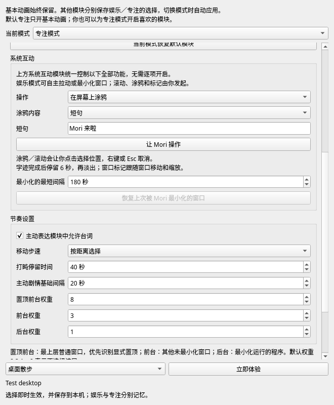

# 模块与动画节奏

右键或托盘 → **互动设置**。娱乐与专注的开关分别保存，模式切换自动应用对应选择；可以在专注中只开鼠标注视，也可以为娱乐关闭走动。基本动画一直开启，用户主动点击、拖拽与工作反馈始终保留。

| 模块 | 动作范围 | 娱乐默认 | 专注默认 |
| --- | --- | --- | --- |
| 基本动画 | 呼吸眨眼、工作思考／生成／等待／庆祝／安慰、资料收纳、摸头／戳脸／尾巴、抓起／拖动／落地 | 固定开启 | 固定开启 |
| 移动 | 自主散步、小跑、快跑与到达后站定 | 开 | 关 |
| 鼠标互动 | 附近注视、好奇试探、追逐、害羞回望 | 开 | 关 |
| 窗口互动 | 左右探头、上沿趴着偷看、坐下晃腿、起身、碰按钮、问候后台软件 | 开 | 关 |
| 休息 | 伸懒腰、入睡、长一些的打盹、醒来 | 开 | 关 |
| 主动表达 | 主动庆祝、日常念头、生活小剧情与工作短动作 | 开 | 关 |
| 系统互动 | 真实拖动／缩放／贴边、最小化／最大化、页面滚动、临时涂鸦与窗口标记 | 关 | 关 |

同一组原画可以用于不同触发：例如工作完成的庆祝属于基本动画，自动开心庆祝属于主动表达。关闭主动表达不会关闭成功／失败的工作反馈。鼠标追逐同时需要移动模块；只开启鼠标互动时仍能原地注视。窗口剧情自身的走近和离开属于窗口模块，移动模块控制自主散步。系统互动独立于窗口表演，以当前模式的总开关统一控制全部功能，没有各功能的独立开关。旧“允许真实最小化恶作剧”已移除；保存时将旧设置迁移到模块选择，旧字段不再作为执行条件。

设置即时生效并保存；“当前模式恢复默认模块”只重置这一列。旧的走动、鼠标、窗口开关会保留为娱乐模式的初始选择。隐藏或关闭模块会停止相关动作和计时，全部可选模块关闭时只保留基本动画与工作反馈。

## 按意义控制节奏

| 动作 | 节奏与结束条件 |
| --- | --- |
| 散步 | 标称 72px/s，步幅周期约 56px，约 5 次关键姿势变化/s |
| 小跑 | 标称 135px/s，步幅周期约 64px，约 8 次关键姿势变化/s |
| 快跑 | 标称 220px/s，步幅周期约 76px，约 12 次关键姿势变化/s |
| 自动步速 | 路程小于 140px 散步，140–320px 小跑，更远快跑；也可固定一种步速 |
| 移动结束 | 时长按路程与速度计算，带起步／减速；到达目标就收步，随后站定或进入窗口动作 |
| 打盹 | 约 0.52s 入睡 → 默认 40s 轻微呼吸停留 → 约 0.78s 醒来，停留可设 10–300s |
| 窗口探头 | 左右各约 5.2s，上沿偷看约 6s；完整探出、停留与收回 |
| 坐窗沿 | 约 1.45s 坐下 → 12s 轻轻晃腿 → 1.25s 起身 |
| 碰按钮 | 约 1.2s 观察 → 1.05s 伸手轻碰 → 0.9s 收手；真实最小化前观察约 3s |
| 伸懒腰 | 完整拉伸与放松约 2.8s |
| 后台问候 | 约 3s 打招呼 → 7s 安静陪伴 |
| 主动触摸与落地 | 摸头稍多停留、戳脸较轻快、尾巴保持短反应；落地与整理裙摆约 1.22s |
| 害羞退开 | 先按实际方向走一小段，再停下回望，不用右向姿势向左滑动 |
| 思考／生成／等待 | 跟随当前工作状态，直到新的工作状态到来或既有状态过期 |
| 成功／失败／收纳 | 原画节奏约 2.8s／3.2s／2.8s，再停留在恢复姿态；GIF 按情绪适当放慢，反馈期限保证完整播放 |

三种步速复用已确认的四张步态原画，通过位移速度、距离对应的步频、重心幅度和过渡时长细分，不额外改动原画。表中数值为标称速度／步频，起步和减速会同步改变实际步频。打盹停留阶段以 200ms 更新间隔播放轻微呼吸；醒来后恢复普通节奏。工作到来时，在当前位置结束主动剧情并显示最新工作表情。

各组姿势通过共享时长策略重排节奏，保留全部关键姿势及左右一致性，坐下／起身的支撑点换帧和位置插值同步使用新时序。工作中的思考、生成、等待继续跟随状态；悬空持续到松手，移动持续到目标位置。开发阶段的原画、清单与 GIF 存档保留原始制作时序；实际桌宠应用最新节奏。

原有主动剧情的新用户基础间隔默认 45s，实际静默时间为设置值的 1.15–1.35 倍；已有用户保存的数值不改写。默认约 52–61s 后再开始下一段剧情，打盹和坐窗沿结束后也重新留出完整间隔。日常台词每 45s 独立尝试播放；鼠标持续靠近时，注视约 2.4s，再安静约 4s。主动点击、抓起、拖拽和工作事件不增加等待，真实最小化的独立冷却设置继续生效。

生活内容另有 636 条语料、36 张新姿势和 36 段动作：工作时每约 1–3 分钟播放不到 4 秒的原地短段，空闲时每约 30–90 秒展开完整生活剧情；六类主题内容量一致，前三类出现更频繁。近期吃饭、休息和互动会改变后续台词与动作选择。见 [生活语料与动画](living-companion.md)。

## 气泡与动画独立调度

开启当前模式的“主动表达”及台词后，日常碎碎念使用独立计时器，在 nothing／eat／think 待机阶段和任务开始／思考／生成状态中都能触发。例如思考动作持续播放时，可以冒出“脑子偷偷开饭了。”。台词不会切换或重启动画，不修改真实任务状态；工作时使用工作与走神台词，待机时继续混用 `talk/nothing.txt` 台词，避免连续重复。

特定动作仍显式绑定台词：待机进食入场说“米饭，好吃。”，待机思考入场说“刚刚要干嘛来着？”，登场、摸头／戳脸／尾巴、抓起、资料收纳和剧情步骤使用各自分组。绑定只在相应动作或事件触发时执行，单纯切换工作动画不会重复播报事件台词。固定正文统一维护在 `talk/fixed.txt`，待机绑定通过 `character/dialogue.py` 的 `IDLE_ANIMATION_SPEECH` 读取；剧情绑定继续使用 `Step.speech`。全量台词及本地 TTS 导出见 [台词本说明](dialogue-scriptbook.md)。

日常台词避让正在显示的气泡、任务提醒动作和队列、点击／拖拽、剧情以及打开的面板。等待输入、成功或失败反馈期间不播碎碎念。隐藏或关闭主动表达会停止日常台词计时，恢复后重新等待完整间隔，不补播错过的台词。专注模式默认仍静默，也可单独开启主动表达。

## 头顶气泡

消息改为圆形思考气泡，用两个小圆点指向实际可见的头部。探头／坐窗沿的姿势偏移与左右朝向参与定位，同一段姿势的呼吸和摆动不挪动气泡；结束窗口动作后重新使用桌面姿势的头部位置。空间足够时避开正在互动的软件窗口与角色的原生窗口，屏幕顶部放不下时改放侧面。位置更新合并到绘制之后；文字变化时一次更新尺寸和位置，并清除旧的透明轮廓。

本次最小本地验证包含五项气泡／拖拽／左右探头检查、修改文件的 Ruff 检查，以及两个 KDE/XWayland 原生气泡探针。使用临时演示窗口播放探头时，气泡位置与原生编号不变，演示窗口没有额外重绘，桌面焦点不变；未对用户的软件窗口注入输入或执行窗口操作。实际应用中的闪烁仍需加载修改后观察。布局预览见 [圆形气泡](../output/bubble-study/preview.png)。

## Codex 的原文与重要提醒

实时 CLI 消息采用独立的任务提醒通道：运行中安静待机，普通原文在后台／被覆盖时短暂拿笔，十秒内合并动画；阻塞选项立即敲黑板，并行选项延迟二十秒。已查看就停止重复，待选标记保留到 Codex 确认请求结束；中断连接不会伪造“已回答”。任务结束只庆祝一次，失败明显提醒，中断不播放提醒。详情、重复间隔及平台边界见 README 的“监听 Codex CLI”。

Codex 气泡单独缓存，默认鼠标穿透；连续悬停圆形主体满三秒才允许点击，移出后立即恢复穿透。通过现有 QWindow 切换输入穿透，不重新设置 QWidget 窗口类型，不隐藏或重建原生窗口。允许点击时原生轮廓裁成主体和两个小圆点，排除透明矩形四角；穿透状态完整绘制透明背景。互动设置提供 20–100% 不透明度，日常台词与 Codex 气泡即时应用并保存。日常台词始终穿透，不监听悬停。继续沿用头部锚点、避开角色原生窗口及目标软件窗口、绘制后合并定位的闪烁修复。敲黑板和拿笔使用已有的四张姿势及代码绘制道具，直接画在角色窗口中；点击／拖拽优先，排队的提醒在直接互动结束后播放。展开原文后保留当前文字和阅读位置，新内容只增加未读标记。“回到这个任务”才会切换窗口／标签页。

拖拽黑框修复：永久圆形遮罩会裁切 Qt 的原生缓冲区刷新，本地 XWayland 检查发现遮罩外四角实际为不透明黑色（`0xff000000`），而 `QWidget.grab()` 得到的透明图片不能反映这个问题。现在首次显示、日常表达和移动／换文字前移除遮罩，完整绘制透明背景；任务气泡悬停解锁后才应用点击轮廓。`tests/manual_bubble_alpha_smoke.py` 直接读取临时窗口的 XComposite 缓冲区，修复前首次显示检查失败，修复后显示、解锁、拖动、改变尺寸、隐藏后复用均为透明（alpha=0）；同时检查原生输入区域、窗口编号及桌面焦点，无输入注入。最小相关验证为六项气泡／拖拽自动测试、这一原生探针和修改 Python 文件的 Ruff 检查。特定桌面特效是否是用户可见黑框的触发条件，仍需加载修改后的应用观察。

## 全身朝向一致

停下后朝屏幕内侧，中央留有小范围稳定区，避免来回转向。基础工作、触摸、休息等动作转向时，整个人物一起转，触摸区域和拖拽抓取点同步换算。鼠标注视会保持身体位置，同时把视线指向实际鼠标；反射时同时交换左右视线素材。

| 左侧 Mori，朝右 | 右侧 Mori，朝左 |
| --- | --- |
|  |  |

移动每次按实际位移选择左／右／伪上／伪下。目标窗口移动时，从 Mori 当前坐标重新规划路线，保留已经走过的步态相位；身体朝向跟随新的实际位移。坐下、起身和上沿偷看同步反射支撑点与完整轮廓，仍需通过屏幕和窗沿空间检查。左右探头分别沿用相应原画，伸手按按钮保持手掌与按钮的接触位置。

## 系统互动

在互动设置中开启当前模式的“系统互动”，下方同名区域选择操作，点击“让 Mori 操作”。娱乐模式可以自主轻拉当前窗口或按最小化按钮；专注模式开启后可手动操作。滚动、涂鸦与窗口标记始终由用户发起。最小化间隔和恢复入口也归入系统互动区域，“节奏设置”只保留普通动画节奏参数。

窗口操作通过 KWin 6 执行，手的位置跟随确认后的真实窗口几何。移动帧至多每 40ms 提交一次，只有一个请求在途，其余合并为最新位置；末帧确认后才松手。用户开始拖动或缩放目标时 Mori 在当前位置结束动作。缩放和贴边为手动入口；最大化窗口须先还原才能拉动。完整姿势放不下时跳过动作。按钮按 KWin 配置的左右位置与顺序定位，伸手姿势随之转向，接触帧到达时执行；自绘标题栏的按钮中心仍为估算，实际结果由窗口管理器执行。

涂鸦支持星星、圈圈、箭头、小鲸鱼和至多 32 字的短句。选择后点击落笔位置，右键或 Esc 取消。拿笔、书写和收笔使用新增四张姿势，笔尖与线条共享轨迹；分笔之间抬笔移动，不画连接线。文字描绘字体轮廓，不模拟汉字笔顺。屏幕涂鸦固定在屏幕坐标，窗口标记按窗口相对坐标跟随移动和缩放；目标关闭、最小化或离开当前桌面时消退。画完后保留 6 秒，再用 1 秒淡出，最多保留 8 组。笔迹窗口不获取焦点，允许鼠标穿透，不写入应用、不修改文件。

滚动时点击当前窗口的内容区域，Mori 走近后用手拨动，发送连续滚动事件。鼠标保持在所选区域，移动鼠标或切走窗口就会结束滚动。Wayland 使用 XDG RemoteDesktop Portal，仅申请指针权限，不申请键盘、截图或剪贴板；首次使用由桌面显示输入授权对话框，授权后若位置改变则重新选择滚动区域。需要系统 PyGObject/GIO，或安装可选依赖 `python -m pip install -e '.[desktop-input]'`。X11 使用系统 XTest，Windows 使用系统滚轮事件；本机验证环境为 KDE Wayland，其他平台的滚动实现尚未进行实机验证。

关闭系统互动会撤销待执行操作、取消位置选择、结束输入会话并清除笔迹；隐藏角色和退出也清理绘制窗口与计时器。恢复已被 Mori 最小化的窗口入口在模块关闭后仍可用。排除软件、普通窗口身份检查和最小化冷却继续生效。

新增十二张透明姿势与原画见 [system-study-v6](../output/system-study-v6/README.md)。本地最小验证包括模块／动作／姿势检查、临时子进程窗口的真实移动、最大化／还原与最小化恢复，以及私有 D-Bus 上的指针权限、滚动事件和会话清理；验证不会向用户应用发送滚动，真实页面滚动仍需首次桌面授权后确认。
