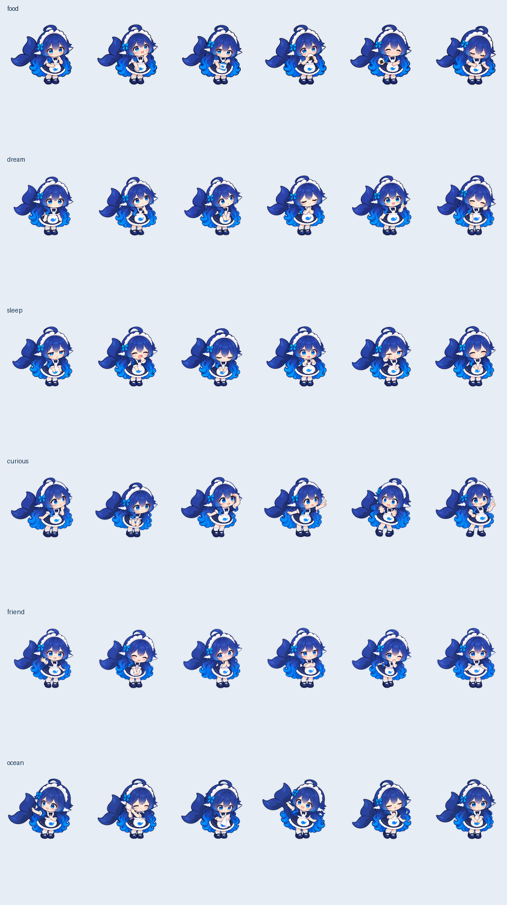

# 生活语料与动画素材

六张原画通过内置 image_gen 生成，以 `src/asset_library/motion/base-nothing-0.png` 为角色身份和画风参考，完整提示词见 [prompts.json](prompts.json)。生成源图在 `sources/`；正式 36 张透明 PNG 和 36 段清单位于 `src/asset_library/motion/`，各自的 GIF 预览在 `gifs/`。

| 主题 | 短动作预览 | 完整剧情预览 |
| --- | --- | --- |
| 吃饭 | [摸肚子](gifs/life-hungry.gif) | [吃饭团](gifs/life-snack.gif) |
| 发呆 | [想小云](gifs/life-cloud.gif) | [念头散步](gifs/life-daydream.gif) |
| 困倦 | [点头惊醒](gifs/life-nod.gif) | [浅眠与醒来](gifs/life-doze.gif) |
| 好奇 | [踮脚看看](gifs/life-tiptoe.gif) | [试探箭头](gifs/life-arrow.gif) |
| 朋友 | [偷偷等你](gifs/life-wait.gif) | [假装生气](gifs/life-pout.gif) |
| 海边 | [听浪声](gifs/life-shell-listen.gif) | [擦贝壳](gifs/life-shell.gif) |

接触表为浅色底诊断图片，正式 PNG 保持透明。GIF 用于预览，桌宠使用按原时长播放的关键姿势与现有平滑过渡。原画含有的独立装饰符号不进入正式角色轮廓。导出脚本按完整连通轮廓提取，避免等分网格截断尾巴或混入相邻姿势。

详细内容数量、节奏、模块和近期记忆规则见 [生活陪伴文档](../../docs/living-companion.md)。
